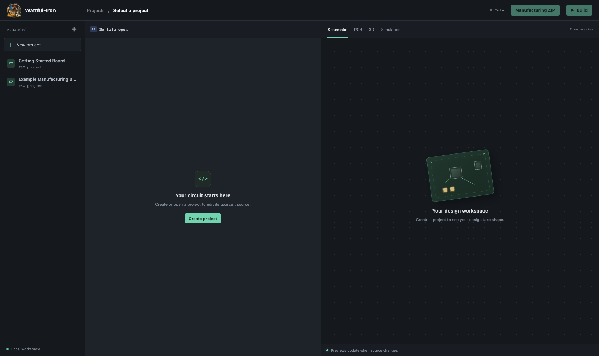
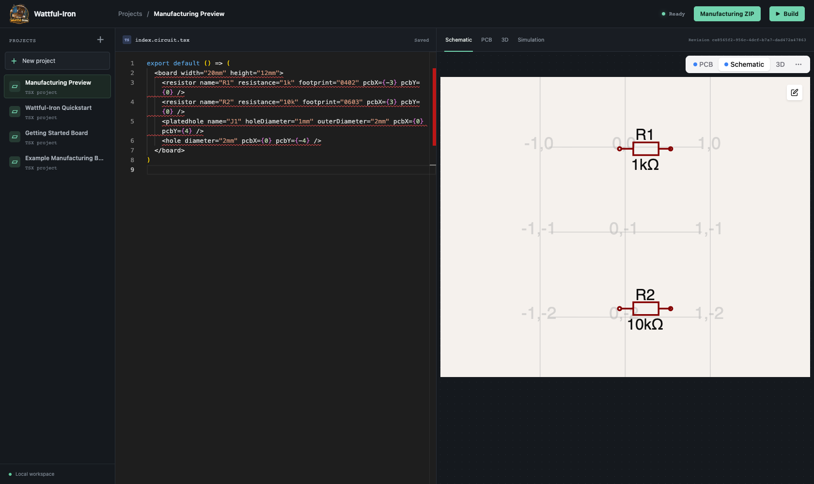
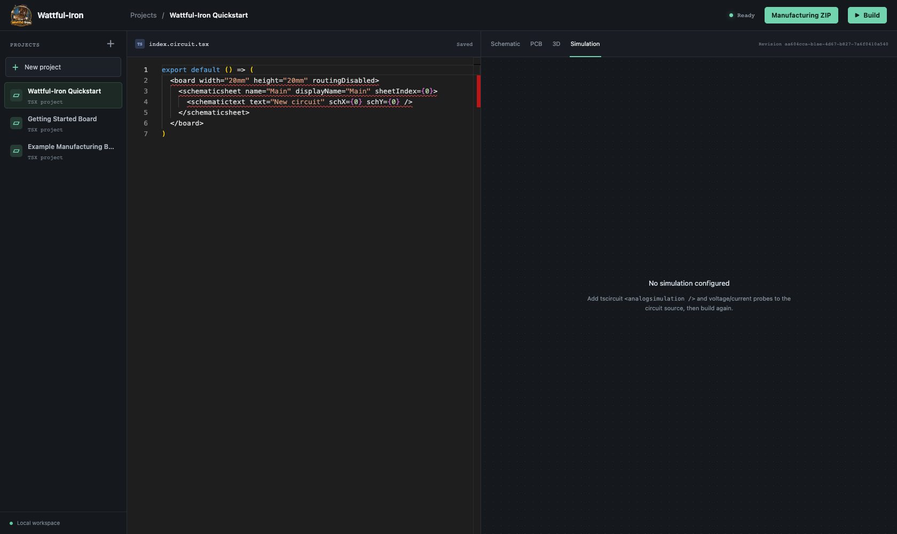

# Wattful-Iron

**Fresh circuits, made to order.**

`Wattful-Iron` is an early, self-hosted electronics design workbench built around
tscircuit. The current slice provides browser project management and editing,
build diagnostics, schematic, PCB, and 3D previews, and inspection of transient
SPICE results produced by tscircuit. It is still a prototype;
see [current scope](docs/architecture.md) before relying on it for engineering
sign-off or fabrication.

## Run with Docker Compose

Requirements: Docker Engine with the Compose plugin. Clone the repository, then:

```sh
cp .env.example .env
mkdir -p .secrets
openssl rand -hex 32 > .secrets/build-runner-token
chmod 600 .secrets/build-runner-token
docker build --target build-job -t wattful-iron-build-job:local .
docker compose up --build -d
docker compose logs -f circuits
```

Install and register gVisor `runsc` on the Docker Engine host first, and set
`RUNNER_DOCKER_SOCKET` in `.env` to that Engine's socket. See the
[deployment guide](docs/deployment.md) for the full setup. Open
<http://127.0.0.1:3000>. Compose stores projects in the named volume
`circuits-projects` and exposes the app only on loopback by default. Set
`HTTP_PORT` in `.env` to change the host port. Keep `BIND_ADDRESS=127.0.0.1`
when a reverse proxy on the same host terminates TLS. See
[deployment](docs/deployment.md) for GHCR, Swarm, proxy, backup, and upgrade
instructions.

The API image runs as the unprivileged `node` user and has no Docker socket.
Builds run in disposable worker containers. Compose expects a Docker Engine
with gVisor `runsc` installed; see the [deployment guide](docs/deployment.md)
for host setup and the separately built worker image. The worker is limited to
two concurrent jobs by default.

## Current scope

This prototype supports project create/list/open and file read/write, a browser
source editor, tscircuit builds, retained Circuit JSON preview data, live SSE
updates, diagnostics, schematic/PCB/3D previews, and a waveform panel for
transient results included in the successful build. Add tscircuit analog
simulation elements and probes to the circuit source to configure a simulation.
Use **Run simulation** to rebuild the current source on demand. The panel only
displays transient graph data emitted by tscircuit. Treat all views as
development previews rather than engineering approval.

ACP agent interfaces, user-level authentication, and full KiCad-equivalent
ERC/DRC are not implemented in this slice. MCP agents can run the supported
electrical, board, and routing rule checks and read IPC-2221 trace current
capacity; every report names the checks it does not evaluate. Manufacturing preflight runs the
supported tscircuit Circuit JSON checks and a limited set of fabricator rules.
Project code runs in disposable build containers;
see the [security model](docs/security.md) for the runtime boundary and limits.
An optional shared-token MCP endpoint, manufacturing preflight, and
preflight-gated Gerber/drill/BOM/pick-and-place ZIP export are available. These
do not provide user-level authorization or engineering sign-off. Do not expose
the service to untrusted users or treat its output as a manufacturing release.
More detail is in
[security limitations](docs/security.md).

## Screenshots

The screenshots below were captured from a running local build. See the
[quickstart](docs/quickstart.md) and [workbench how-tos](docs/workbench-howtos.md)
to reproduce the workflow.







The [connected LED indicator and filtered voltage divider examples](docs/workbench-howtos.md#trace-a-powered-example-circuit)
show named nets and generated PCB copper routes.

## Development

```sh
npm ci
npm ci --prefix web
npm run build
BUILD_EXECUTION_MODE=trusted-local npm start
```

The service listens on `PORT` (default `3000`) and stores projects under
`PROJECTS_DIR` (default `./projects` for local development; the container sets
it to `/data/projects`). `trusted-local` runs project code on the host and is
for trusted development projects only; production mode rejects it. To test the
isolated path locally, run the build-runner service with its configured Docker
Engine and worker image. `GET /healthz` is the container health endpoint.

## Documentation

- [Quickstart: run the workbench and build a first circuit](docs/quickstart.md)
- [Workbench how-tos: edit, preview, simulate, export, and connect MCP](docs/workbench-howtos.md)
- [Architecture and feature status](docs/architecture.md)
- [Project source history, compare, restore, and retention](docs/source-history.md)
- [Manufacturing preflight and exports](docs/manufacturing.md)
- [Pull request and release process](docs/releasing.md)
- [Deployment, proxy, backups, upgrades, and Swarm](docs/deployment.md)
- [Testing and container acceptance](docs/testing.md)
- [Linting](docs/linting.md)
- [Security model and limitations](docs/security.md)
