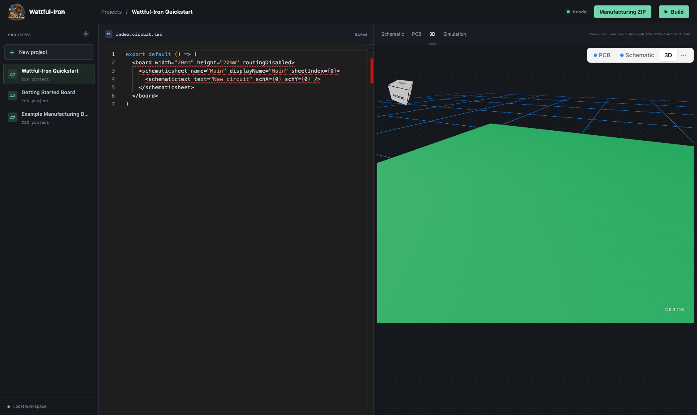
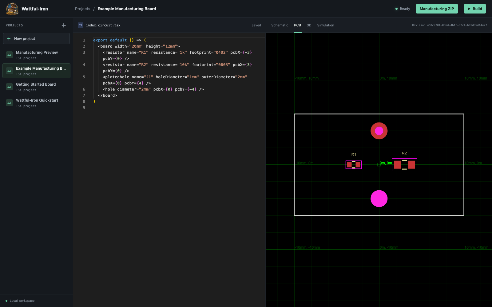
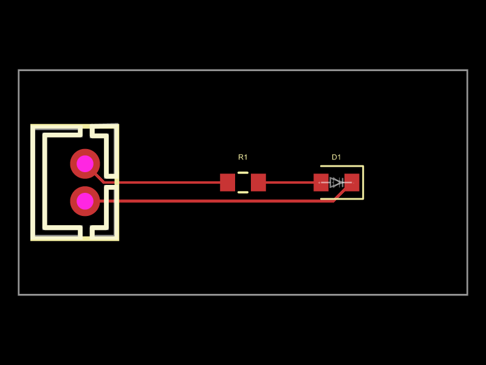
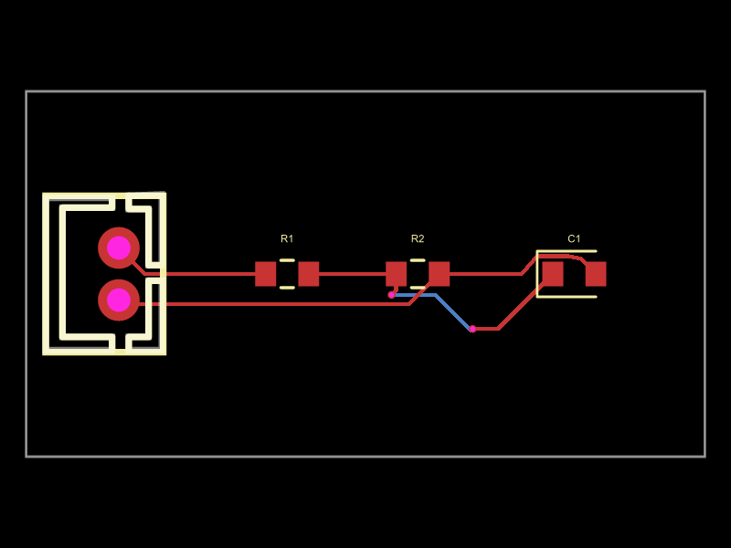

# Workbench how-tos

## Import and export a project archive

Use **Import project archive (.zip)** under the project list to add a project
from a Wattful-Iron ZIP. The imported project appears in the list as a separate
project. Opening it uses the regular unsaved changes prompt, so edits in the
current project can be saved, discarded, or kept open while you decide.

Open a project and choose **Export project ZIP** in the top bar to download its
visible source files and project manifest. The ZIP can be imported into another
Wattful-Iron workspace. Export does not include hidden server data or generated
build artifacts. Archives are limited to 20 MB compressed, 50 MB expanded,
500 entries, and 10 MB per file; invalid archives show an error and do not
replace the open project.

The same operations are available through the REST API:

Export a project's visible source files as a ZIP archive:

```sh
curl -f http://127.0.0.1:3000/api/projects/PROJECT_ID/export -o project.zip
```

Import the ZIP as a new project. The optional `name` query parameter overrides
the archived project name:

```sh
curl -f -X POST 'http://127.0.0.1:3000/api/projects/import-archive?name=My%20copy' \
  -H 'Content-Type: application/zip' --data-binary @project.zip
```

`GET /api/projects/:id/export` responds with `application/zip`. The archive
contains UTF-8 project files and `_wattful_project.json` with `version: 1`,
`name`, and `entrypoint`. `POST /api/projects/import-archive` accepts raw
`application/zip` bytes and responds `201` with the newly created project
metadata. If `name` is omitted, the manifest name is used. Invalid archives
respond `400`; unknown export project IDs respond `404`.

Archives are limited to 20 MB compressed, 50 MB expanded, 500 entries, and
10 MB per file. Import rejects traversal, hidden or server-reserved paths,
symbolic links, duplicate filenames, encrypted/ZIP64 archives, non-UTF-8 file
contents, and archives without a manifest and existing entrypoint. Export
omits hidden server data and packages project text files only.

These steps assume the app is running and you have opened a project. If this is
your first visit, follow the [quickstart](quickstart.md).

## Edit a circuit and inspect a build

Open a project from the **Projects** list. Edit its `index.circuit.tsx` file in
the source pane. The editor saves changes automatically and the server starts a
debounced build. Use **Build** to request a build immediately. Wait for
**Ready** before relying on the preview; a failed build displays diagnostics
in the preview area. A failed build does not replace the last successful
preview.

## Explore a project without changing the original

Select the duplicate icon beside a project in the **Projects** list. Wattful-Iron
copies the editable files, project configuration, imported circuit data, and PDF
references into a separate project, then opens the copy. The copy has its own
revision history and builds independently. If the editor has unsaved changes,
choose **Save and open**, **Discard and open**, or **Cancel** before duplication
starts.

Use the **Schematic**, **PCB**, and **3D** tabs to change preview type. The
example manufacturing board source is at
[`examples/manufacturing-board/index.circuit.tsx`](../examples/manufacturing-board/index.circuit.tsx).



## Keep a schematic PDF beside your project

Choose **New project**, enter a project name, and select the schematic PDF under
**Import PDF as a visual reference**, or paste a public HTTPS URL that allows
cross-origin access. Open the project and choose **PDF reference** in the top
bar. The PDF remains available beside the editor and preview, including
multi-page documents up to 20 MB.

This import preserves the PDF as a visual reference. It does not create
components, pin assignments, net labels, or electrical connections. Add the
corresponding circuit in the TSX editor and use the PDF to compare the drawing.

## Import an EasyEDA Standard schematic

Choose **New project**, enter a project name, and select the EasyEDA Standard
schematic `.json` file under **Import schematics (KiCad or EasyEDA)**. Wattful-Iron
converts the file to KiCad schematic text and uses the same Circuit JSON and
editable-source flow as KiCad imports. The server needs KiCad 10 with
`kicad-cli` on `PATH` (or `KICAD_CLI_PATH` set to the executable) to upgrade the
converted schematic. The uploaded JSON is retained in the project's `imports/`
folder. Multi-sheet files currently import their first sheet; the original
file remains available for reference.

The initial preview comes from the converted Circuit JSON; generated
tscircuit source remains best-effort and should be reviewed and built before
further editing.

## Compare footprints and board mechanics

Create a **Footprint comparison** project to compare 0402, 0603, and 0805 resistor
footprints at the same scale. The two rows use different resistance values;
the plated holes mark the board ends. Edit the `pcbX` and `pcbY` values to
reposition a part, or change the board dimensions to see how the outline moves.
The example is a placement study: it has no electrical connections or copper
routing, so it is not a manufacturing-ready circuit.

Create a **Mounting pattern** project to explore how a larger outline, four mounting
holes, two plated holes, and a small resistor group fit together. Try moving
the mounting holes as a set, then inspect the PCB bounds and spacing in the
viewer. This is also a mechanical layout study, not a connected sensor design.

Create either example from **New project** by choosing **Footprint comparison**
or **Mounting pattern** under **Start from**. Wattful-Iron copies the source
into your project, so edits do not change the repository example.

## Read a simulation result

Add tscircuit analog simulation elements and voltage or current probes to the
source, select **Simulation**, then choose **Run simulation**. Wattful-Iron
saves the current editor source and starts a normal tscircuit build; the panel
then shows transient waveforms or build/simulator diagnostics from the emitted
Circuit JSON. If it says **No simulation configured**, the build did not emit
simulation and probe data. See [implemented simulation scope](architecture.md#implemented-in-this-slice).


## Inspect a PCB preview

Select **PCB** after the build reaches **Ready**. The viewer includes layer,
routing, bounds, and measurement controls. The manufacturing example shows its
board outline, two placed components, plated hole, and non-plated hole.

Open **Components** and select a component to focus its footprint in the PCB
viewer. To move from a footprint back to its source component details, open the
PCB component's context menu and choose its **on Schematic** action. This
switches to the schematic view and selects that component in the inspector.
The schematic and 3D canvases do not draw selection highlights.



## Trace a net across views

Open **Nets** in the preview toolbar, or choose **Trace net** beside a pin in
the component inspector. The net inspector lists, for the selected net:

- every component pin on the net, and whether copper on that net reaches it,
- the schematic wires that carry it,
- its copper traces with length, layers, and width, plus any vias,
- the simulation signals whose probes reference it.

Nets come from the connectivity map in the build, so source traces that share a
port appear as one net. **Focus footprint** moves to the PCB view and focuses
that pin's component; **Open waveforms** switches to the simulation panel.

Simulation signals whose probes carry no net reference are counted as
uncorrelated at the bottom of the panel. The schematic, PCB, and 3D viewers
expose no highlight API, so a selected net is reported by ID and geometry rather
than drawn highlighted. Connectivity tracing is not signal propagation: a routed
net says nothing about its electrical behavior.

## Draw or import a custom board outline

Open the **PCB** view and choose **Board outline**. Click the canvas to place
boundary points, edit their X/Y coordinates in millimeters, or remove and add
points. The editor starts with the board's current rectangular dimensions or a
literal outline already declared in the source. Choose **Apply outline** to
write the polygon to the active `<board>` element; the normal save and build
flow updates the PCB and 3D views and manufacturing exports.

To import a boundary, choose an SVG containing exactly one `<polygon>` or
`<polyline>`, with a `viewBox`, and explicit `width` and `height` in mm, cm,
inches, or px. Curved SVG paths, transforms, and multiple shapes are not
converted. The imported points are scaled to the SVG's physical dimensions and
centered on the board origin. The editor rejects outlines with fewer than three
points, zero area, or self-intersections. For profiles that depend on
rectangular board dimensions, manufacturing preflight asks for manual edge
clearance review on a polygon outline.

## Download manufacturing files

1. Build the latest source and wait until the top bar says **Ready**.
2. Select **Manufacturing ZIP**. The button is available only for a successful
   build of the current source revision.
3. Review the downloaded ZIP with your fabricator and assembler before use.

The preflight checks the current successful build, PCB board, reference
designators, placed footprints, Circuit JSON errors, and the selected rule
profile. The JLCPCB profile covers trace width, non-plated hole diameter,
rectangular board-edge clearance, and declared layer/material compatibility;
it does not cover every DRC or assembly rule. The ZIP contains Gerber layers,
drill files when needed, a BOM, and pick-and-place data. Read
[manufacturing preflight](manufacturing.md) for the exact checks and limits.

## Connect an MCP client

The MCP endpoint is disabled until you configure a shared bearer token. For a
local trusted setup, create one in the shell that will launch the service:

```sh
export MCP_AUTH_TOKEN="$(openssl rand -hex 32)"
npm run build
npm start
```

Then configure Codex or Claude Code using the examples in the
[MCP guide](mcp.md). The token grants access to every project on the service;
keep it private and use HTTPS for connections over a network.

## Troubleshoot a build

- **The editor says Saved but the preview is old:** wait for the build indicator
  to leave **Compiling**. A save triggers a debounced build.
- **The build failed:** read the diagnostics shown in the preview, fix the
  source, and select **Build** again.
- **The file changed outside the editor:** use **Reload file** in the message
  to load the latest revision before editing further.
- **Manufacturing ZIP is disabled:** confirm there is a current successful
  build. Preflight also requires a PCB board, references, and footprint
  geometry.
- **The editor reports that JSX is disabled:** reload the workbench so Monaco
  applies its JSX-enabled TypeScript settings. Use the server's **Ready** or
  **Failed** build result to check the tscircuit build.

## Trace a powered example circuit

Create a project for each example from **New project** by choosing **Connected
LED indicator** or **Filtered voltage divider** under **Start from**, then
build and inspect both the Schematic and PCB tabs. The LED
indicator connects a 2-pin JST-PH power connector through a 1 kΩ resistor and
green LED.
The voltage-divider example uses two 10 kΩ resistors for a half-supply `SENSE`
output and a 100 nF capacitor to filter that node. Their named traces join
specific component pins, so the schematic nets and PCB copper come from the
same source connections.





These are teaching layouts, not reviewed production designs. Both use the
JST-PH 2-pin connector standard. The LED example uses a Lite-On
LTST-C190KGKT; check part availability, pin orientation, input limits, and
your assembler's exact footprints. The voltage-divider output is unbuffered
and will vary with the load. Run the assembler's full electrical and
manufacturing-rule checks and review the generated Gerbers before ordering.
Wattful-Iron's preflight does not certify these electrical choices or guarantee
a fabricator's acceptance.
